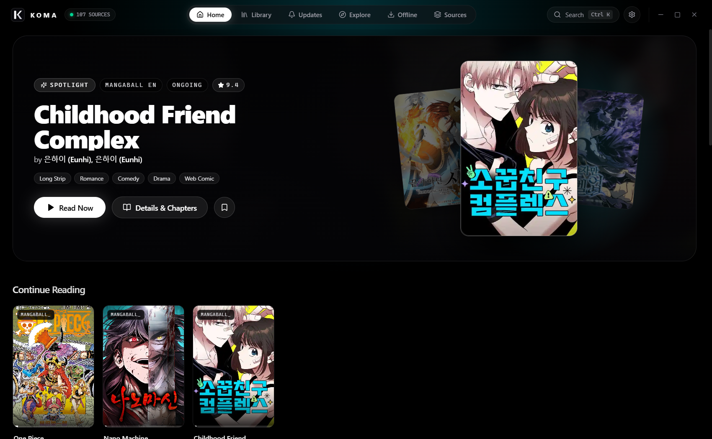
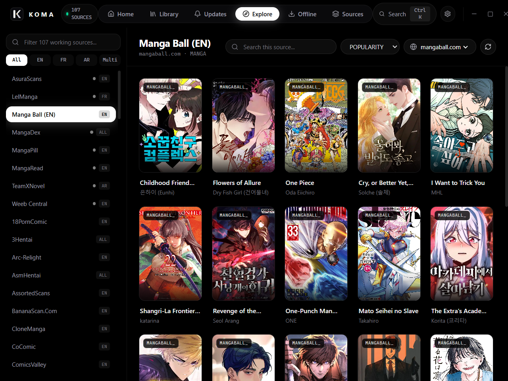

<div align="center">
  
  <h1>K O M A</h1>
  <p><strong>Manga &amp; Manhwa Reader for Windows, Android Phones &amp; Tablets</strong></p>
  <p><sub>By VirtualDrum</sub></p>

  <p>
    <a href="https://nourddinachi20-rgb.github.io/KOMA/">
      
    </a>
    <a href="https://github.com/nourddinachi20-rgb/KOMA/releases/latest">
      
    </a>
    
    
  </p>

  <h3>
    <a href="https://nourddinachi20-rgb.github.io/KOMA/">Open Download Page →</a>
  </h3>
</div>

---

## Screenshots (PC · Tablet · Phone)

<table>
  <tr>
    <td width="58%">
      
      <p align="center"><sub><strong>Windows Desktop</strong></sub></p>
    </td>
    <td width="42%">
      
      <p align="center"><sub><strong>Android Tablet</strong></sub></p>
    </td>
  </tr>
  <tr>
    <td width="58%">
      
      <p align="center"><sub><strong>Reader</strong> — Webtoon / RTL / Spread, Zoom &amp; Chapters Drawer</sub></p>
    </td>
    <td width="42%" align="center">
      
      <p align="center"><sub><strong>Android Phone</strong></sub></p>
    </td>
  </tr>
</table>

<details>
  <summary><strong>Series Details Screenshot</strong></summary>
  <br />
  
</details>

---

## Features

- **Zero Setup:** Standalone `KOMA-Portable.exe` on Windows and self-contained `KOMA-Android.apk` on Android phones &amp; tablets.
- **Customizable Appearance &amp; Languages:** Pure black-and-white OLED default with Dark Slate &amp; Light Paper themes, custom accent color picker, and English / French / Arabic UI (more languages coming soon).
- **EN / FR / AR Sources:** Built-in MangaBall, MangaDex, AsuraScans, WeebCentral, MangaRead, LELManga, TeamXNovel, and Cloudflare solver.
- **Adaptive Reader:** Auto-detects Webtoon vs RTL Manga per series, zoom, auto-scroll, chapter list drawer (`C`), and OLED black ink preset.
- **Offline CBZ &amp; Tracking:** Save chapters as `.cbz`, import local archives, sync with AniList, and update Windows/Android directly in Settings.

---

## Downloads

| Platform | File | Link |
| --- | --- | --- |
| **Download Page** | Windows + Android + QR | [**nourddinachi20-rgb.github.io/KOMA**](https://nourddinachi20-rgb.github.io/KOMA/) |
| **Windows (x64)** | `KOMA-Portable.exe` | [**Download Portable EXE**](https://github.com/nourddinachi20-rgb/KOMA/releases/latest/download/KOMA-Portable.exe) |
| **Android (8+)** | `KOMA-Android.apk` | [**Download Android APK**](https://github.com/nourddinachi20-rgb/KOMA/releases/latest/download/KOMA-Android.apk) |

---

## Build From Source

```bash
npm install
npm run dev              # Windows desktop dev
npm run pack:portable    # Windows KOMA-Portable.exe
npm run build:ui         # Build UI bundle
npx cap sync android     # Sync Android web assets
node scripts/build-website.mjs  # Rebuild docs/ download page
```

<div align="center">
  <sub>Made by <strong>VirtualDrum</strong></sub>
</div>
